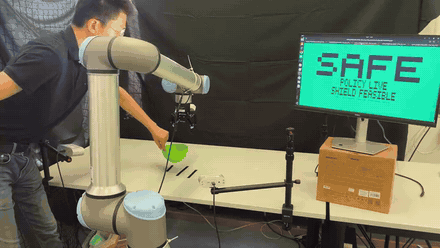
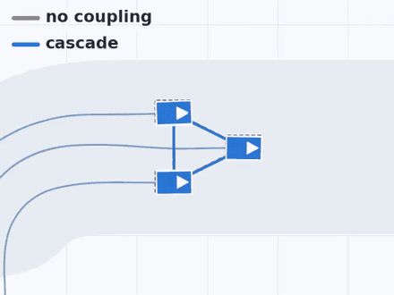

<h1 align="center">Hi, I'm Yunfei Bi</h1>

  <b>Robot learning</b> &nbsp;·&nbsp; <b>Control theory</b> &nbsp;·&nbsp; <b>Simulation for autonomous driving</b>

  
  
  

I am a master's student in Mechatronics, Robotics and Biomechanical Engineering at the [Technical University of Munich (TUM)](https://www.tum.de/en/), after a B.Sc. in Vehicle Engineering at [Tongji University](https://en.tongji.edu.cn/). My interests include **robot learning**, **control theory** and **simulation for autonomous driving**. I wrote my master's thesis at Prof. Schoellig's [Learning Systems and Robotics Lab](https://www.ce.cit.tum.de/lsy/home/) and my semester thesis at Prof. Althoff's [Cyber-Physical Systems Group](https://www.ce.cit.tum.de/cps/home/), both at TUM. I was a research intern at [Siemens](https://www.siemens.com/) Technology in Garching and am currently a working student at [Agile Robots SE](https://www.agile-robots.com/).

  
  
  
  
  
  
  
  

## Research Highlights

### [Learning Trustworthy Human-Robot Collaboration Policies from Human-Human Demonstrations](https://yunfei-bi8.github.io/Trustworthy-HRC-from-Human-human-videos/)

Master's thesis · Learning Systems and Robotics Lab, TUM · 2026

 

- **Learning from human-human videos:** both people's hand skeletons from markerless RGB video drive and condition a diffusion policy; exchanging the roles teaches both sides of a task, including roles with no robot demonstration.
- **Embodiment-feasibility safety layer:** a diffusion-based feasibility score with a calibrated threshold stops the robot before motions its gripper cannot perform.
- **On a UR10e:** 18/20 successes with five robot demonstrations (5/20 robot-only), 13/20 in zero-shot roles, 19/20 infeasible motions stopped before contact.

---

### [CommonRoad-Game: A Human-in-the-Loop Simulation Framework for Autonomous Driving](https://arxiv.org/abs/2607.01382)

<b>Yunfei Bi</b>, Youran Wang · semester thesis · Cyber-Physical Systems Group, TUM · 2026

  

- **Human in the loop:** a lightweight simulator tightly integrated with [CommonRoad](https://commonroad.in.tum.de/) for testing motion planners with human drivers.
- **Time synchronisation:** a multi-threaded architecture aligns simulation time with wall-clock time; drift 402&nbsp;ms → 1.5&nbsp;ms.
- **Reproducible scenarios:** recorded driving logs become test cases; IDM and sampling-based planners are integrated.

---

### [Delay-Tolerant Formation Tracking for Multi-AGV Systems](https://bi-yunfei.github.io/agv-formation/)

Research internship · Siemens Technology Center Garching · 2025 · technical report 2026

 

- **Cascade design:** delayed Wi-Fi data only shift each AGV's own reference, so stability holds for every bounded delay and any directed, switching communication graph.
- **On the robots:** C++ implementation with MQTT-based distributed communication, deployed in Docker.
- **Verified:** audited Lyapunov proofs and 4,894 high-fidelity simulation runs; no instability up to 4&nbsp;s latency and 12 vehicles, formation error &minus;47&nbsp;% after a safety stop.

## Experience

&nbsp;
&nbsp;
&nbsp;

- **Agile Robots SE** · working student, foundation models for robotics: VLA post-training and inference acceleration · 05/2026 – present
- **TUM, Learning Systems and Robotics Lab** · master's thesis (03/2026 – present) and teaching assistant for Advanced Robot Learning and Decision Making (04/2026 – 05/2026)
- **Siemens AG, Technology Center Garching** · research intern, Lyapunov-based formation control of mobile robots · 08/2025 – 11/2025
- **TUM, Cyber-Physical Systems Group** · semester thesis, CommonRoad-Game · 07/2025 – 02/2026

More on <a href="https://bi-yunfei.github.io/">bi-yunfei.github.io</a> · <a href="mailto:yunfei.bi@tum.de">yunfei.bi@tum.de</a>

