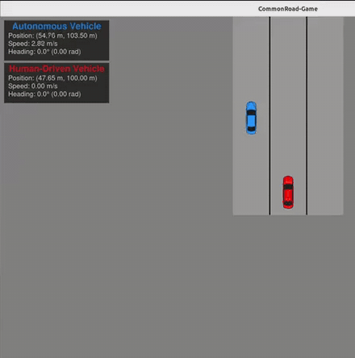

<h1 align="center">Hi, I'm Yunfei Bi</h1>

  <b>Robot learning</b> &nbsp;·&nbsp; <b>Control theory</b> &nbsp;·&nbsp; <b>Simulation for autonomous driving</b>

  
  
  

I am a master's student in Mechatronics, Robotics and Biomechanical Engineering at the [Technical University of Munich (TUM)](https://www.tum.de/en/), after a B.Sc. in Vehicle Engineering at [Tongji University](https://en.tongji.edu.cn/). My interests include **robot learning**, **control theory** and **simulation for autonomous driving**. I wrote my master's thesis at Prof. Schoellig's [Learning Systems and Robotics Lab](https://www.ce.cit.tum.de/lsy/home/) and my semester thesis at Prof. Althoff's [Cyber-Physical Systems Group](https://www.ce.cit.tum.de/cps/home/), both at TUM. I was a research intern at [Siemens](https://www.siemens.com/) Technology in Garching and a working student at [Agile Robots SE](https://www.agile-robots.com/).

  
  
  
  
  
  
  
  

## Research Highlights

<table>
<tr>
<td width="320" align="center" valign="top">

  

</td>
<td valign="top">

**[Learning Trustworthy Human-Robot Collaboration Policies from Human-Human Demonstrations](https://yunfei-bi8.github.io/Trustworthy-HRC-from-Human-human-videos/)** 
Master's thesis · Learning Systems and Robotics Lab, TUM · 2026

 

- **Learning from human-human videos:** hand skeletons of both people drive and condition a diffusion policy; exchanging roles also teaches roles with no robot demonstration.
- **Embodiment-feasibility safety layer:** X-Diffusion's robot-versus-human discriminator, read at every control cycle and calibrated on successful runs, stops the robot before motions its gripper cannot perform.
- **Results:** 18/20 successes on a UR10e with five robot demonstrations (5/20 robot-only); in 13,860 simulated runs, 98.3&nbsp;% and 100&nbsp;% of the infeasible runs stopped, at most 0.6&nbsp;% of the feasible ones.

</td>
</tr>
<tr>
<td width="320" align="center" valign="top">

  

</td>
<td valign="top">

**[Delay-Tolerant Formation Tracking for Multi-AGV Systems via Reference-Shift Coupling](https://bi-yunfei.github.io/agv-formation/)** 
arXiv preprint 2026 · research internship at Siemens Technology Center Garching, 2025

  

- **Cascade design:** delayed Wi-Fi data only shift each AGV's own reference, so stability holds for every bounded delay and any directed, switching graph.
- **Verified:** reviewed Lyapunov proofs and 4,894 high-fidelity simulation runs; no failure up to 4&nbsp;s latency and 12 vehicles, formation error &minus;47&nbsp;% after a safety stop.

</td>
</tr>
<tr>
<td width="320" align="center" valign="top">

  

</td>
<td valign="top">

**[CommonRoad-Game: A Human-in-the-Loop Simulation Framework for Autonomous Driving](https://arxiv.org/abs/2607.01382)** 
<b>Yunfei Bi</b>, Youran Wang · semester thesis · Cyber-Physical Systems Group, TUM · 2026

  

- **Human in the loop:** a lightweight simulator tightly integrated with [CommonRoad](https://commonroad.in.tum.de/) for testing motion planners with human drivers.
- **Time synchronisation:** simulation time aligned with wall-clock time; drift 402&nbsp;ms → 1.5&nbsp;ms.
- **Reproducible scenarios:** recorded driving logs become test cases; IDM and sampling-based planners are integrated.

</td>
</tr>
</table>

## Experience

<table>
<tr>
<td width="200" align="center"></td>
<td><b>Agile Robots SE</b>, Munich · working student, foundation models for robotics 05/2026 – 10/2026 · VLA post-training and inference acceleration</td>
</tr>
<tr>
<td width="200" align="center"></td>
<td><b>Learning Systems and Robotics Lab, TUM</b> · master's thesis and teaching assistant 03/2026 – present · trustworthy human-robot collaboration; TA for Advanced Robot Learning and Decision Making</td>
</tr>
<tr>
<td width="200" align="center"></td>
<td><b>Siemens AG</b>, Technology Center Garching · research intern 08/2025 – 11/2025 · Lyapunov-based formation control of mobile robots</td>
</tr>
<tr>
<td width="200" align="center"></td>
<td><b>Cyber-Physical Systems Group, TUM</b> · semester thesis 07/2025 – 01/2026 · CommonRoad-Game, human-in-the-loop simulation for autonomous driving</td>
</tr>
</table>

More on <a href="https://bi-yunfei.github.io/">bi-yunfei.github.io</a> · <a href="mailto:yunfei.bi@tum.de">yunfei.bi@tum.de</a>

