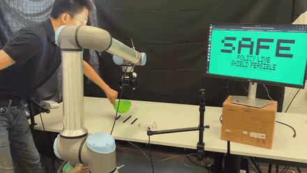
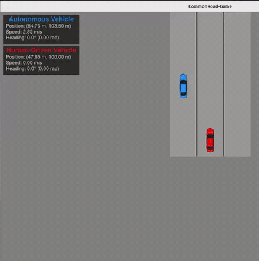

  
  

## Hi, I'm Yunfei Bi

M.Sc. student in Mechatronics, Robotics and Biomechanical Engineering (MRBE) at the Technical University of Munich. I work on **robot learning**, in particular **learning from cross-embodiment data**, **human-robot interaction** and **simulation frameworks in robotics**, with diffusion policies and vision-language-action (VLA) models. Currently a working student on foundation models for robotics at [Agile Robots SE](https://www.agile-robots.com/).

**More on my website: [bi-yunfei.github.io](https://bi-yunfei.github.io/)**

## Research Highlights

<table>
  <tr>
    <td width="42%" valign="top"></td>
    <td valign="top">
      <b><a href="https://yunfei-bi8.github.io/Trustworthy-HRC-from-Human-human-videos/">Learning Trustworthy Human-Robot Collaboration Policies from Human-Human Demonstrations</a></b> 
      Master's thesis, Learning Systems and Robotics Lab, TUM, 2026 · paper to be submitted to IEEE RA-L
      <ul>
        <li><b>HRC from human-human videos:</b> both people's hand skeletons are recovered from markerless RGB video; one hand drives the gripper, the partner's hand conditions a diffusion policy, and reading every video once per hand teaches both roles, including roles with no robot demonstration (zero-shot).</li>
        <li><b>Embodiment-feasibility safety layer:</b> the number of forward-diffusion noise steps needed to explain an action chunk is a feasibility score learned from feasible actions alone; a calibrated threshold stops the robot before it attempts a motion its gripper cannot perform.</li>
        <li><b>On a UR10e:</b> 18/20 successful runs vs. 5/20 robot-only; 13/20 and 14/20 in zero-shot roles; 19/20 infeasible motions stopped before contact.</li>
      </ul>
      <a href="https://yunfei-bi8.github.io/Trustworthy-HRC-from-Human-human-videos/">Project page</a>
    </td>
  </tr>
  <tr>
    <td width="42%" valign="top"></td>
    <td valign="top">
      <b><a href="https://arxiv.org/abs/2607.01382">CommonRoad-Game: A Human-in-the-Loop Simulation Framework for Autonomous Driving</a></b> 
      <b>Yunfei Bi</b>, Youran Wang · arXiv preprint, 2026 · semester thesis, Cyber-Physical Systems Group, TUM
      <ul>
        <li>Lightweight human-in-the-loop simulator tightly integrated with <a href="https://commonroad.in.tum.de/">CommonRoad</a>, for testing motion planners with human drivers.</li>
        <li>Multi-threaded architecture aligns simulation time with wall-clock time (drift 402&nbsp;ms → 1.5&nbsp;ms) for deterministic interaction of autonomous and human-driven vehicles.</li>
        <li>Recorded driving logs become reproducible test scenarios; IDM and sampling-based planners are integrated.</li>
      </ul>
      <a href="https://arxiv.org/abs/2607.01382">arXiv</a> · <a href="https://github.com/Yunfei-Bi8/CommonRoad-Game">Code</a>
    </td>
  </tr>
</table>

Contact: yunfei.bi@tum.de
